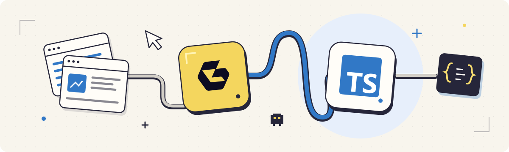

# Geonode TypeScript SDK: Web Scraping & Data Extraction

Build server-side JavaScript and TypeScript agents with Geonode’s typed clients. Extract pages, crawl sites, discover URLs, search the web and run batches. Feed results into your AI features and data workflows, with webhook subscriptions and usage statistics available from your code.

**[Try Geonode for free](https://app.geonode.com/sign-up)**

[Integrations page](https://geonode.com/integrations) · [Geonode API docs](https://docs.geonode.com/docs/scraper-api) · [TypeScript SDK setup guide](https://docs.geonode.com/docs/scraper-api/guides/sdks/typescript) · [View package on npm](https://www.npmjs.com/package/@geonode_scraper/scraper-sdk) · [View source on GitHub](https://github.com/geonodecom/sdk-typescript) · [Complete guide](docs/guide.md)

<!-- BEGIN README NAV -->
[Get started](#get-started) · [Example: prepare website content for retrieval](#example-prepare-website-content-for-retrieval) · [Setup questions](#setup-questions)
<!-- END README NAV -->

## Workflow ideas

- **Add website import to your app.** Accept a URL on your server, extract its content, and return the result to your application.
- **Refresh background data.** Submit a batch or crawl, retain the job ID, and process results after completion.

## Get started

Requires Node.js 18 or newer, with ES modules and built-in fetch and a [Geonode API key](https://app.geonode.com/). API requests use your Geonode account's plan and balance.

```sh
npm install @geonode_scraper/scraper-sdk
```

Set `GEONODE_SCRAPER_API_KEY` in your server environment, then run:

```ts
import { Configuration, ExtractionApi, OutputFormat } from "@geonode_scraper/scraper-sdk";

const apiKey = process.env.GEONODE_SCRAPER_API_KEY;
if (!apiKey) throw new Error("Set GEONODE_SCRAPER_API_KEY");

const api = new ExtractionApi(new Configuration({ apiKey }));
const result = await api.extractV1ExtractPost({
  extractRequest: {
    url: "https://example.com",
    formats: [OutputFormat.Markdown],
  },
});
if ("data" in result) console.log(result.data.markdown);
```

The SDK sends your key in `X-Api-Key` to `https://scraper.geonode.io`. Keep the key out of source control and browser code. Use an ES-module project or an .mts file for the TypeScript example.

## What you can build

| Task | Client |
| --- | --- |
| Extract a page as Markdown or HTML, with optional JavaScript rendering | `ExtractionApi` |
| Process many URLs and check or cancel jobs | `BatchApi` |
| Crawl linked pages with depth and page limits | `CrawlApi` |
| Discover a website's URLs | `MapApi` |
| Search the web | `SearchApi` |
| Configure notifications and manage delivery secrets | `WebhooksApi` |
| Inspect concurrency, usage and service health | `UsageApi`, `StatisticsApi`, `SystemApi` |

See the [complete guide](docs/guide.md) for background extraction, batch and crawl examples, proxy settings, webhooks, error handling and the method reference. Generated method names follow the API contract. The SDK is an API client; it does not bundle a local browser or MCP server.

<!-- BEGIN SHARED WORKFLOW GUIDE -->
## Understand the extraction result

The TypeScript quick start requests Markdown and reads data.markdown from a completed extraction. Request HTML when you need data.html. Keep metadata.url alongside the content so later processing retains its source. tokens_charged reports the request's usage.

A background request returns a job ID and status instead of immediately returning finished content. Keep that ID, retrieve the job and inspect its terminal status before reading the result. A timeout after submission is not a reason to submit the same job again.

## Example: prepare website content for retrieval

1. Start with a small list of source URLs, or map a site and select the relevant pages.
2. Extract Markdown from one URL and inspect its content and source metadata before processing the list.
3. Use a batch for a known URL list, or a crawl with explicit depth and page limits when you need linked pages.
4. Pass completed content to your own chunking and embedding pipeline, then store the chunks with their source URLs and retrieval time.
5. Handle failed pages separately so partial results do not silently become a complete dataset.

**Expected result:** Page content and source metadata are ready for your application. Embeddings, vector storage, product-field parsing and change detection are separate steps you supply.

## Setup questions

Missing content? Confirm the requested format and whether the job has completed. Enable JavaScript rendering when the target depends on a browser, and inspect the returned status and error details.

Where does the API key belong? Keep it in your server environment and pass it through the SDK configuration. A browser application should call your own server instead of exposing the key.

Does installing the SDK run a scraper locally? It installs an API client. Extraction runs through the hosted Geonode service and uses your account's allowance.

Need MCP? Use the separate hosted MCP connection for a compatible assistant; this SDK does not start an MCP server.

These recipes describe source-supported workflows. They have not been run as authenticated end-to-end examples in this review.
<!-- END SHARED WORKFLOW GUIDE -->

## Development

Development checks require Node.js 20, 22 or 24+ because the test tooling has a newer requirement than the SDK runtime.

```sh
npm ci
npm run lint
npm test
npm run typecheck
npm run build
npm pack --dry-run
```

Read [CONTRIBUTING.md](CONTRIBUTING.md) for the workflow and [source provenance](docs/source-provenance.md) for regeneration and release migration. Package publishing remains in the original SDK monorepo until the release configuration is migrated. This repository does not publish automatically.

## Support and license

Use [GitHub issues](https://github.com/geonodecom/sdk-typescript/issues) for SDK bugs and [Geonode support](https://geonode.com/contact) for account or API questions. Report vulnerabilities privately using [SECURITY.md](SECURITY.md). Released changes are listed in [CHANGELOG.md](CHANGELOG.md).

[MIT license](LICENSE) · Copyright 2026 Geonode Team.

**[Try Geonode for free](https://app.geonode.com/sign-up)**
